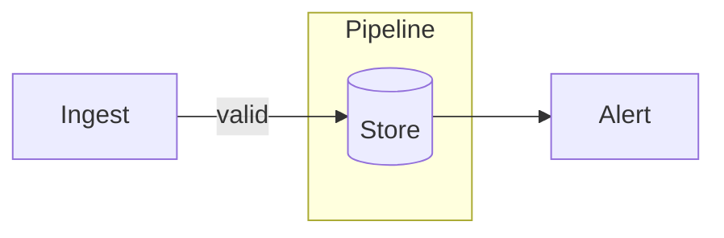
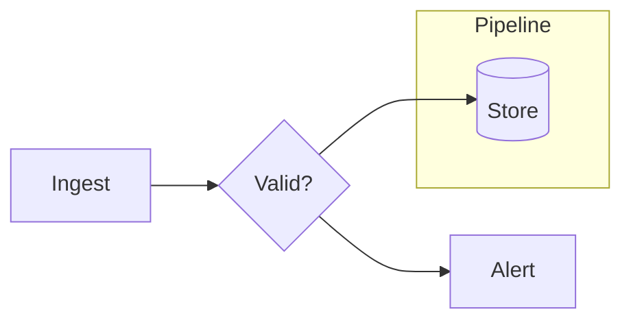
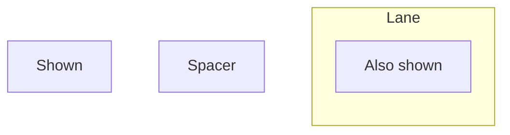

# pele-preview

Live browser preview of a [Mermaid](https://mermaid.js.org) diagram, rendered by
[pele](https://pele.run), with your own CSS. Point it at a `.mmd` file and it opens
a page that re-renders whenever you save the diagram or the stylesheet. When you
are happy, export the same thing as one self-contained SVG.

```sh
pele-preview docs/architecture.mmd theme.css                  # live preview
pele-preview docs/architecture.mmd theme.css -o diagram.svg   # export and exit
```

pele is a pure-JavaScript renderer, so there is no headless browser, no `mmdc`
and no puppeteer config to wrangle.

## Requirements and install

Node 20 or newer. That is all.

```sh
npm install && npm link      # or: npm i -g .
```

## Usage

```
usage: pele-preview DIAGRAM.mmd [STYLE.css] [options]

  -o, --output FILE    write a self-contained SVG to FILE and exit (no server)
  -c, --css FILE       stylesheet (same as the second positional argument)
  -p, --port N         port to serve on (default: ephemeral)
  -n, --no-open        don't open a browser, just print the URL
  -B, --browser APP    open in a specific app (macOS only), e.g. "Google Chrome"
      --scheme MODE    auto | light | dark (default: auto). light or dark
                       fixes the SVG, and the preview, to that scheme; auto
                       follows the viewer.
  -h, --help           show this message
```

Exit codes: `0` success, `1` render or I/O failure, or the preview
server could not start, `2` usage error.

A render that fails in preview mode leaves the last good diagram on screen,
greyed out, with the error above it. Fix the file and it recovers.

---

## Styling

Your CSS travels **inside the SVG**, as a `<style>` element, so the exported file
looks the same everywhere it is opened. The preview page applies no styling of
its own to the diagram beyond a background: what you see is what you ship. (The
page otherwise styles only its own chrome, the error banner and the padding
around the diagram.) The page's own colors match `--scheme` (see Light and dark
below), and it fills the diagram's area with `--pele-bg` (white unless
your CSS sets it), so the diagram always sits on its own background. The
exported SVG has no background of its own: set `--pele-bg` *and* paint it, e.g.
`.pele { background: var(--pele-bg, #fff); }`, if the file needs one.

pele's output has no `<style>` of its own. Its defaults are fallbacks written into
the root `<svg>`'s inline style, such as `--_s:var(--pele-surface,#f3f3f3)`, and
shapes read them through presentation attributes like `fill="var(--_s)"`. That
gives you two ways to style, and they combine freely.

### 1. Set pele's variables on `.pele`

```css
.pele { --pele-surface: #eae7e7; --pele-accent: #205ea6; }

@media (prefers-color-scheme: dark) {
  .pele { --pele-surface: #383535; }
}
```

| Variable | What it controls |
|---|---|
| `--pele-bg`, `--pele-fg` | background and text |
| `--pele-muted` | secondary text |
| `--pele-line` | edges and arrows |
| `--pele-surface`, `--pele-surface-alt` | node fills |
| `--pele-border` | node outlines |
| `--pele-accent`, `--pele-critical` | highlights and warnings |
| `--pele-radius` | corner radius |
| `--pele-font`, `--pele-font-mono` | text and monospace families |
| `--pele-series-1` ... `--pele-series-8` | chart series colors |

The full list, and which diagram types use which, is in the upstream
[theming docs](https://pele.run/theming).

### 2. Target pele's classes

`.pele-node`, `.pele-edge`, `.pele-label`, `.pele-cluster` and friends are
ordinary classes on ordinary SVG elements:

```css
.pele-node > rect { stroke-width: 2px; }
```

Because pele sets colors as presentation attributes, and any CSS rule beats a
presentation attribute, **a plain selector wins with no `!important`**.

### Writing a stylesheet, step by step

This section builds one stylesheet, `theme.css`, in five steps. Put the pieces
in one file, in this order, and pass it to pele-preview:
`pele-preview diagram.mmd theme.css`. Everything here lands in the SVG's
`<style>` element. The upstream [theming docs](https://pele.run/theming) list
every variable and class pele offers; `pele-plex.css` is a fuller worked example
of the same steps.

#### Step 1: Fonts

```css
@import url("https://fonts.googleapis.com/css2?family=Inter:wght@400;600&family=JetBrains+Mono&display=swap");

.pele {
  --pele-font: "Inter", system-ui, sans-serif;
  --pele-font-mono: "JetBrains Mono", ui-monospace, monospace;
  --pele-title-weight: 600;
  --pele-heading-weight: 600;
  --pele-bold-weight: 600;
}
```

- **`@import` comes first.** CSS ignores an `@import` that follows any other
  rule, so it must be the first line of the file.
- **`--pele-font`** is the family for all label text, and **`--pele-font-mono`**
  the family for monospace text (step 5 uses it).
- **List fallbacks.** The web font loads only when the viewer is online and the
  SVG is opened directly or inlined in a page. A browser showing the SVG
  through `` loads nothing external, so it uses the next family in the
  list.
- **Size isn't a variable.** pele lays text out at its own default size,
  whatever the family (see Gotchas). To change the size, scale relative to it,
  as in step 4.

#### Step 2: Colors, with eight tones in light and dark

pele reads its colors from `--pele-*` variables. Set the base colors and eight
series colors, the tones, once for light, then again for dark:

```css
.pele {
  --pele-bg: #ffffff;
  --pele-fg: #1a202c;
  --pele-muted: #718096;
  --pele-line: #4a5568;
  --pele-surface: #f7fafc;
  --pele-surface-alt: #edf2f7;
  --pele-border: #a0aec0;
  --pele-accent: #3182ce;
  --pele-series-1: #2b6cb0;  /* blue */
  --pele-series-2: #c05621;  /* orange */
  --pele-series-3: #2f855a;  /* green */
  --pele-series-4: #c53030;  /* red */
  --pele-series-5: #6b46c1;  /* purple */
  --pele-series-6: #975a16;  /* amber */
  --pele-series-7: #2c7a7b;  /* teal */
  --pele-series-8: #b83280;  /* pink */
}
@media (prefers-color-scheme: dark) {
  .pele {
    --pele-bg: #1a202c;
    --pele-fg: #f7fafc;
    --pele-muted: #a0aec0;
    --pele-line: #cbd5e0;
    --pele-surface: #2d3748;
    --pele-surface-alt: #4a5568;
    --pele-border: #718096;
    --pele-accent: #63b3ed;
    --pele-series-1: #63b3ed;
    --pele-series-2: #f6ad55;
    --pele-series-3: #68d391;
    --pele-series-4: #fc8181;
    --pele-series-5: #b794f4;
    --pele-series-6: #f6e05e;
    --pele-series-7: #4fd1c5;
    --pele-series-8: #f687b3;
  }
}
```

- **The series colors do two jobs.** pele colors chart slices and branches
  with them (pie charts and git graphs, for example), and step 3 uses them for
  flowchart nodes.
- **Keep the eight apart and readable.** Use eight clearly different hues.
  In light mode they need to be dark enough to read against `--pele-bg`, and
  in dark mode light enough.
- **Define every variable you use.** pele never sets `--pele-*` itself, so a
  rule using `var(--pele-surface)` gets nothing unless this file sets it (see
  Gotchas).
- **Write dark mode as a media query,** as above, so `--scheme` can fix the SVG
  to one side (see Light and dark below).

#### Step 3: Use the tones in flowcharts

pele copies Mermaid class names onto the SVG, so a class in the diagram is a
class you can style. Give each tone a class that sets `--tone`, then tint nodes
and subgraphs with it:

```css
.pele .tone-1 { --tone: var(--pele-series-1); }
.pele .tone-2 { --tone: var(--pele-series-2); }
.pele .tone-3 { --tone: var(--pele-series-3); }
.pele .tone-4 { --tone: var(--pele-series-4); }
.pele .tone-5 { --tone: var(--pele-series-5); }
.pele .tone-6 { --tone: var(--pele-series-6); }
.pele .tone-7 { --tone: var(--pele-series-7); }
.pele .tone-8 { --tone: var(--pele-series-8); }

/* Nodes: a light tint of the tone, outlined in the tone. */
.pele .pele-node[class*="tone-"] > :not(text) {
  stroke: var(--tone);
}
.pele .pele-node[class*="tone-"] > :not(text, [fill="none"]) {
  fill: color-mix(in srgb, var(--tone) 18%, var(--pele-surface));
}

/* Subgraphs: a lighter tint, made opaque (pele draws them see-through). */
.pele .pele-cluster[class*="tone-"] > rect {
  fill: color-mix(in srgb, var(--tone) 9%, var(--pele-bg));
  fill-opacity: 1;
  stroke: var(--tone);
}
```

Then, in the diagram:



- **`:::tone-1`** styles one node. **`class C tone-4`** styles one or more
  (`class A,B tone-4`).
- **Subgraphs need a `class` line**, using the subgraph's id: Mermaid doesn't
  allow `:::` on a subgraph.
- **No `classDef` is needed.** A `classDef` would write fixed colors, which
  don't follow the theme (see Gotchas).
- **Tones follow the theme.** They change with light and dark because they
  read `--pele-series-1` to `-8`.

#### Step 4: Boxes around edge labels

pele already draws a box behind each flowchart edge label, filled with
`--pele-bg` and with no outline, so it's invisible on the background. Give it
an outline and rounder corners:

```css
.pele.pele-flowchart .pele-edge-label > rect {
  stroke: var(--pele-border);
  stroke-width: 1px;
  rx: 8px;
  ry: 8px;
}
```

- **`.pele-flowchart` keeps it to flowcharts.** Sequence diagrams draw their
  messages as `.pele-edge-label` too.
- **The box is sized to the text pele laid out.** If you shrink or restyle
  the text (step 5), it still fits. If you grow the text, grow the box too,
  for example
  `transform: scale(1.1); transform-box: fill-box; transform-origin: center;`.

#### Step 5: A second font, such as monospace edge labels

Any text can take another family with an ordinary rule. Here edge labels use
the monospace font from step 1, slightly smaller:

```css
.pele.pele-flowchart .pele-edge-label text {
  font-family: var(--pele-font-mono);
  font-size: calc(0.85 * 1em);
}
```

- **Shrink wider fonts.** pele laid the label out for its own measurements, and
  monospace text usually runs wider, so scale it down (as here) or grow the box
  (step 4) to keep it inside.
- **pele's own monospace option isn't available here.** pele can set chosen
  parts in monospace when rendering (class members, ER attributes, sequence
  messages), but pele-preview doesn't pass that option, so use CSS as above.

### Light and dark

Write the dark side of your theme as `@media (prefers-color-scheme: dark)` (and,
if you like, the light side as `prefers-color-scheme: light`). Then pick how the
SVG uses it:

| `--scheme` | Exported SVG (`-o`) and preview |
|---|---|
| `auto` (default) | carries both; follows the viewer's OS or browser setting |
| `light` | always light, whatever the viewer's setting |
| `dark` | always dark, whatever the viewer's setting |

A web page cannot force `prefers-color-scheme`, so `light` and `dark` work by
rewriting your CSS as it is embedded: each `(prefers-color-scheme: dark)` becomes
a condition that is always true (`(min-width: 0px)`) or never true
(`(not (min-width: 0px))`), and the same for `light`. Your file on disk is never
changed.

The preview shows exactly the SVG that `-o` with the same `--scheme` would
write, and the page around it takes the same scheme. With `auto`, change your
browser's or OS's light/dark setting to see the other side; the preview switches
without a reload. To preview a fixed side, restart with `--scheme light` or
`--scheme dark`.

If your colors are `light-dark()` pairs, as in `pele-plex.css`, decide the
`color-scheme` they resolve against with the same media query, so `--scheme`
can pin it:

```css
.pele { color-scheme: light; }
@media (prefers-color-scheme: dark) { .pele { color-scheme: dark; } }
```

(`color-scheme: light dark` also follows the OS, but no media query is involved,
so `--scheme` cannot reach it.)

Without a stylesheet there is nothing to switch: pele's defaults are a light
theme, so `--scheme dark` shows the light diagram on a dark page.

---

## Coloring nodes and subgraphs (`pele-plex.css`)

`pele-plex.css` is an example IBM Plex theme for pele, with one color scheme
built on IBM Carbon's neutrals and categorical palette, in light and dark. Use
it as the stylesheet, or copy it as a starting point for your own:

```sh
pele-preview diagram.mmd pele-plex.css
```

The eight series colors are available as classes named `tone-1` … `tone-8`. You don't need any `classDef`.

| Target | Syntax |
|---|---|
| One node | `A[Text]:::tone-1` |
| Several nodes | `class A,B,C tone-2` |
| A subgraph | `class SubgraphId tone-3` (use the subgraph's id) |
| Solid fill on a node | Give it a tone, then add `class A solid` on its own line |



### Rules

1. **One class per `:::`.** `A:::tone-4:::solid` is a parse error.
2. **Subgraphs can't use `:::`.** Apply the class with a `class` line instead.
3. **One class per `class` line.** That's why `solid` needs its own line, separate from the tone.
4. **Colors follow the theme.** Tones read the current scheme's `--pele-series-1…8`, so they change with the scheme and with light/dark mode without re-rendering.
5. **Avoid `classDef` and `style` for these.** Colors set that way are fixed hex values that don't change with the theme. They also override the tone styling on that node. Mermaid's parser rejects `var(...)`, so you can't use those to reference theme colors.

### What each one looks like

| Class | Fill | Outline | Text |
|---|---|---|---|
| `tone-N` on a node | 18% tint of the color | Full color | Normal foreground |
| `tone-N` + `solid` | Full color | Full color | Near-black or white, whichever reads better on that tone |
| `tone-N` on a subgraph | 9% tint, opaque | Full color | Title in the color, 25% toward the foreground |

The tint strengths are adjustable with `--plex-tone-node-mix` and `--plex-tone-cluster-mix`, and
how much of the color is in a subgraph's title with `--plex-tone-title-mix` (75%).

### Hiding nodes and subgraphs

The `hidden` class removes a node from view while it still takes part in the
layout, which makes it handy as a spacer:



- **Nodes:** `A:::hidden` or `class A hidden`.
- **Subgraphs:** `class Lane hidden` hides the box and title only. The nodes
  inside are still drawn; hide them with their own class line if you want.
- **Edges** can't be hidden: an edge into a hidden node is still drawn. Join
  hidden nodes with Mermaid's invisible link, `~~~`, which draws nothing.

### Edge labels

Labels on flowchart edges are set in small tracked capitals inside a pill, so
they read as tags rather than as more node text. Each step is relative to the
box and size pele laid the label out at:

- the text shrinks to 72% (capitals and tracking make it wider), is tracked out,
  and set at weight 500;
- the box grows around its own center to fit, into a full pill;
- a label pele wraps onto two or more lines gets a little more room, and its box
  reads as a rounded rectangle;
- sequence-diagram messages are left as pele draws them.

Every step is a knob you can set on `:root` (or any ancestor of the diagram):

| Knob | Default | What it changes |
|---|---|---|
| `--plex-edge-label-scale` | `0.72` | text size, as a share of the size pele laid it out at (capitals need about 0.78 or less) |
| `--plex-edge-label-tracking` | `0.06em` | letter spacing |
| `--plex-edge-label-weight` | `500` | font weight |
| `--plex-edge-label-pad-x` | `1.06` | pill width, as a factor of pele's box |
| `--plex-edge-label-pad-x-wrapped` | `1.14` | pill width for wrapped labels |
| `--plex-edge-label-pad-y` | `1.0` | pill height, as a factor of pele's box |
| `--plex-edge-label-pad-y-wrapped` | `1.18` | pill height for wrapped labels |
| `--plex-edge-label-radius` | unset: a full pill | corner radius, for a soft-cornered tag instead |
| `--plex-edge-label-stroke-width` | `1px` | outline width |
| `--plex-edge-label-fg` | unset: `--pele-fg` | text color |
| `--plex-edge-label-bg` | unset: `--pele-bg` | fill |
| `--plex-edge-label-border` | unset: `--pele-border` | outline color |

### Edge cases

- **`solid` without a tone** falls back to the scheme's accent color.
- **Moved subgraph titles keep the default color.** If a subgraph's title would cross an edge, Pele draws it outside the subgraph's group, so the tone class doesn't reach it.

---

## Gotchas

**pele lays out at its own size; your CSS restyles on top.** pele sizes each
label in Node from a built-in width table at its default size (16px), whatever
font family your CSS names, and draws the boxes to fit. Set the family with
`--pele-font` on `.pele`; to make text smaller or larger, scale it relative to
the size pele laid it out at (for example `font-size: calc(0.8 * 1em)`), and
grow or shrink the box around it to match, as `pele-plex.css` does for edge
labels. Text much wider than pele's table expects can overflow its box. Fonts
are never embedded: viewers need the family installed.

**Some properties only move through their variable.** pele applies the corner
radius with an inline `style="rx:var(--_r)"`, and inline style beats any normal
stylesheet rule. `.pele-node rect { rx: 12px }` does nothing; set `--pele-radius`
instead of reaching for `!important`.

**`style` and `classDef` in the diagram ignore the theme.** They write fixed
colors, so `--pele-surface` will not reach a node that has one. Use them for
deliberate one-offs, or give the node a class and style that from your sheet:
`class A hot` in the diagram puts `hot` on the node's `<g>`, so
`.pele-node.hot > rect { fill: var(--pele-critical, #e45756); }` follows the theme.

**pele never defines its own `--pele-*` variables.** Its defaults live only as
fallbacks inside its inline styles (`var(--pele-surface,#f3f3f3)`). So
`var(--pele-critical)` in your CSS resolves to nothing unless your stylesheet
sets `--pele-critical` itself, and the property silently falls back to its
inherited value (for `fill`, near-black). Give every `var(--pele-…)` you use a
fallback, as above, or define the variables, as `pele-plex.css` does.

**Pasting the SVG into an HTML page leaks the styles.** The embedded `<style>`
applies to the *whole* document once the SVG is inline, so `.pele { ... }` rules
can hit other content. Prefer `` or `<object>`, which keep
the stylesheet scoped to the SVG. (The preview page inlines the SVG, so the same
applies there: that is fine for previewing, but treat the exported file as the
truth.)

---

## Development

```sh
npm test
```
